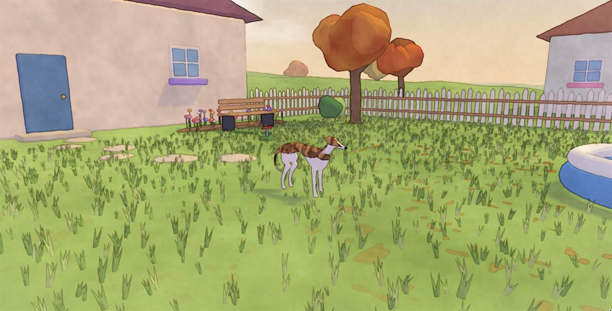

# Merry’s Big Escape

A muddy-pawed adventure for dogs who follow their noses: a watercolour 3D dog game that runs in the browser, on phones, tablets and computers.

**Play the one-dog demo at [merry.ucdev.io](https://merry.ucdev.io).** Nothing to install, and your progress stays on your device.



## What’s in it

- **Escape your garden**, then explore a neighbourhood that’s different in every town: neighbours with jobs, a Lost & Found board, golden bones hidden up high, and bins that are very tempting to knock over.
- **Cheeky heists**: a pastry from the baker while her back’s turned, the butcher’s sausages, someone’s barbecue.
- **Past the edge of town**: the woods, a farm and a beach.
- **Every season**, from the real calendar: snowmen in winter, leaf piles in autumn, an egg hunt in spring and paddling pools in summer.
- **31 dogs to be**, with stars, levels, collars, bandanas and hats.
- **Better in a pack**: friends on the same Wi-Fi join each other with one tap for races, Bone Rush, Pigeon Panic and Duck Round-Up.

## Play at home with friends

The web demo is one dog on its own. The full game runs a small server on a computer at home. You need [Node.js](https://nodejs.org) 22 or newer.

```sh
npm install
npm run play
```

This builds the game and starts the home server on port 8080. It prints the game’s addresses: open one on any phone, tablet or computer on the same Wi-Fi. On Windows you can double-click `play.cmd` instead. Saved dogs, towns and records are kept in `data/`.

## Working on it

| Command | What it does |
| --- | --- |
| `npm run dev` | The workshop: a dev server on port 5173 that reloads as you edit. Its saves go in `data-dev/`, apart from the home server’s. |
| `npm run site:dev` | The merry.ucdev.io page on port 5183. |
| `npm run site` | Builds the page and the one-dog demo into `dist-site/`, which is what merry.ucdev.io serves. |

The game is in beta, with new adventures added often. Each version and what's new in it lives in `src/core/releases.js` (newest first): the game's title screen and Merry's page both show the latest. For a new version, add it at the top and set `version` in `package.json` to match.

Made with [three.js](https://threejs.org), [Vite](https://vite.dev) and a hand-tuned watercolour shader, built with Claude Code.

The real woofs, splashes, waves and gulls are CC0 recordings from [freesound.org](https://freesound.org): who recorded each one is in [public/sfx/CREDITS.md](public/sfx/CREDITS.md).

## Licence

[MIT](LICENSE). The sounds in `public/sfx` are CC0 (public domain).
